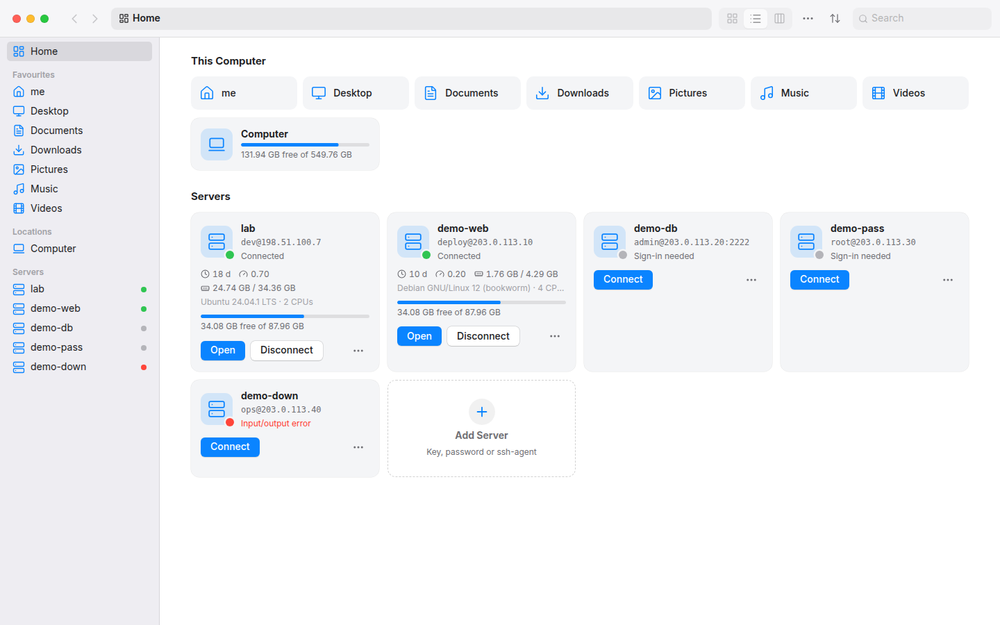
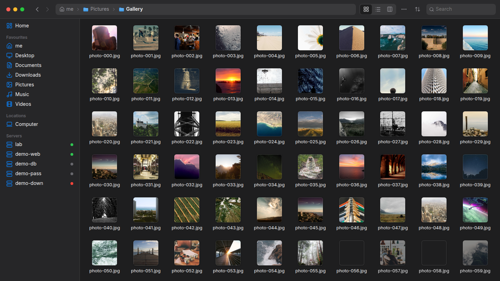
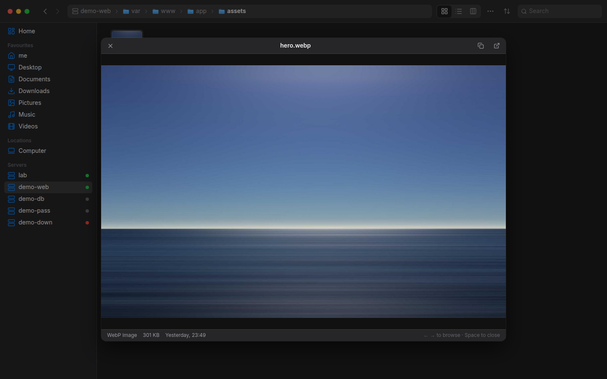
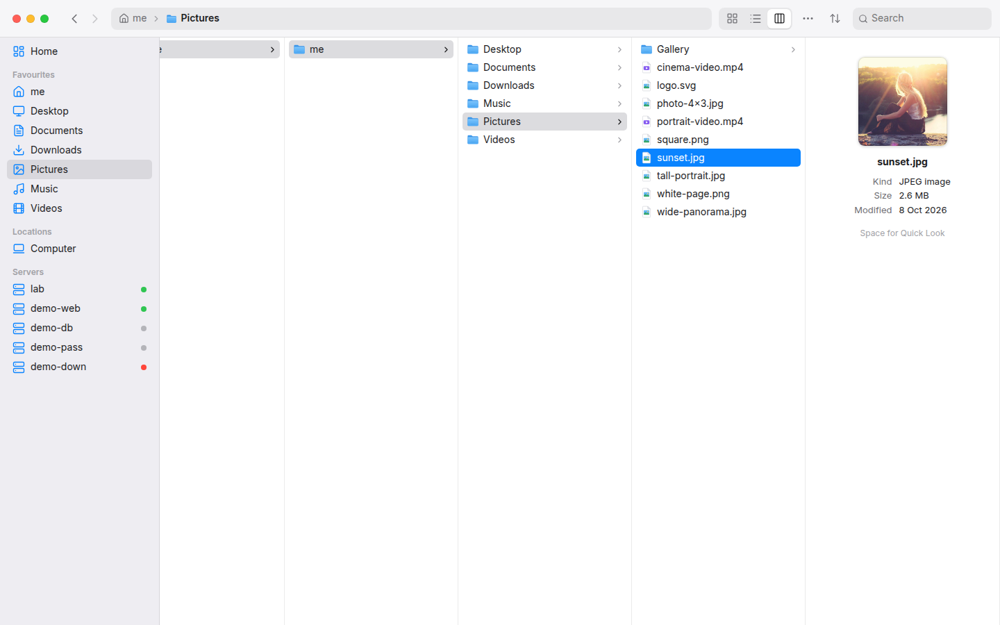
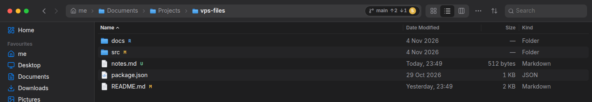

<div align="center">


# VPS Files

**A fast, lightweight, Finder-style file manager for your computer _and_ your servers.**

Every host in `~/.ssh/config` shows up in the sidebar. You can browse it like a local disk,<br/>
copy between any two places, play videos straight from the server and edit remote files in your own apps.

[](https://github.com/FarrukhDevloper/Files/releases/latest)
[](https://github.com/FarrukhDevloper/Files/actions/workflows/ci.yml)
[](https://github.com/FarrukhDevloper/Files/releases)

<br/>


<p>
  <a href="https://github.com/FarrukhDevloper/Files/releases/latest/download/VPS-Files-setup-x64.exe"></a>
  <a href="https://github.com/FarrukhDevloper/Files/releases/latest/download/VPS-Files-x64.msi"></a>
</p>
<p>
  <a href="https://github.com/FarrukhDevloper/Files/releases/latest/download/VPS-Files-amd64.deb"></a>
  <a href="https://github.com/FarrukhDevloper/Files/releases/latest/download/VPS-Files-x86_64.AppImage"></a>
  <a href="https://github.com/FarrukhDevloper/Files/releases/latest/download/VPS-Files-x86_64.rpm"></a>
</p>

<sub>⬆️ Click a button and the download starts right away. Always the latest version. · <a href="https://github.com/FarrukhDevloper/Files/releases">All releases</a></sub>

[📥 Download](#-download) · [✨ Features](#-features) · [📸 Screenshots](#-screenshots) · [🛠️ Develop](#️-develop) · [🗺️ Roadmap](docs/ROADMAP.md)

<picture>
  <source media="(prefers-color-scheme: dark)" srcset="docs/screenshots/home-dark.png" />
  
</picture>

</div>

---

## 📥 Download

| | Direct download | Install |
|---|---|---|
| 🪟 **Windows 10 / 11** | [**VPS-Files-setup-x64.exe**](https://github.com/FarrukhDevloper/Files/releases/latest/download/VPS-Files-setup-x64.exe) · [.msi](https://github.com/FarrukhDevloper/Files/releases/latest/download/VPS-Files-x64.msi) | Double-click and follow the wizard |
| 🐧 **Ubuntu / Debian** | [**VPS-Files-amd64.deb**](https://github.com/FarrukhDevloper/Files/releases/latest/download/VPS-Files-amd64.deb) | `sudo apt install ./VPS-Files-amd64.deb` |
| 🎩 **Fedora / openSUSE** | [**VPS-Files-x86_64.rpm**](https://github.com/FarrukhDevloper/Files/releases/latest/download/VPS-Files-x86_64.rpm) | `sudo dnf install ./VPS-Files-x86_64.rpm` |
| 📦 **Any Linux** | [**VPS-Files-x86_64.AppImage**](https://github.com/FarrukhDevloper/Files/releases/latest/download/VPS-Files-x86_64.AppImage) | `chmod +x VPS-Files-x86_64.AppImage && ./VPS-Files-x86_64.AppImage` |

> [!NOTE]
> 🧪 This is an early **preview**. Linux is tested daily against real servers.
> The Windows build is produced by CI but hasn't been tested on real hardware
> yet, so please [open an issue](https://github.com/FarrukhDevloper/Files/issues)
> if anything looks off. The installers aren't code-signed yet: on Windows,
> SmartScreen may ask you to confirm (**More info → Run anyway**).
> 🍎 macOS is on the [roadmap](docs/ROADMAP.md).

---

## ✨ Features

### 🖥️ Servers feel like local disks
- 🔑 **Zero setup.** Hosts come straight from `~/.ssh/config` (`Include`, `Host *`, ProxyJump), or you add them in the app.
- 🔐 **Every sign-in method.** ssh-agent, key files and passwords all work. Secrets are kept in the **OS keychain**, and known_hosts is checked (hashed entries supported).
- ⚡ **Auto-connect at startup**, silently, and background **auto-reconnect** when a connection drops.
- 📊 **Live server stats** on Home: uptime, load, memory, disk, OS.
- 💻 **Open in Terminal** drops you into the same folder over `ssh`.

### 🚀 Fast by design
- 🏎️ **SFTP at OpenSSH speed.** 64 pipelined requests, directory listings in about 2 round trips.
- 🧠 **Instant navigation** through a listing cache, hover prefetch and optimistic updates.
- 🖼️ **Smart thumbnails.** They come from the EXIF preview (only 128 KB read), a scaled JPEG decode, the freedesktop cache, or ffmpeg running *on the server*.
- 🪶 **Light.** A ~14 MB binary, about 135 MB of RAM, and ~0 % CPU when idle.

### 📂 Move files anywhere
- 🔁 **Copy and move between any two places:** local ↔ VPS ↔ VPS, with a transfer queue, pause and cancel.
- 🧩 **Finder-style conflicts:** Replace (staged, so a failed copy never destroys the original), Merge, Keep Both or Skip.
- 🪟 **Dual pane** (`F3`, then `F5`/`F6`), drag & drop, and drops from your OS file manager.

### ✏️ Open, play, edit
- 📝 **Edit remote files in your own apps.** Every save is uploaded back, and you're warned if the server copy changed in the meantime.
- 🎬 **Stream video and audio** with seeking, in the app or in VLC/mpv, with no full download.
- 👀 **Quick Look** (`Space`) for images, video, audio and text.

### 🌿 Git built in
- 🌱 **Branch, ↑ahead ↓behind and changed-file count** right in the address bar.
- 🏷️ **Status badges** (M · A · D · R · U) on files and folders, an optional Git column, recent commits and an **Open on GitHub** link.
- 🛡️ **Strictly read-only.** It never takes the index lock, so it's safe on production servers.

### 🎨 Feels like a Mac, runs everywhere
- 🗂️ **List, Icon and Column views**, tabs, Home page, an editable address bar with Tab completion.
- 🌓 **Light / dark themes**, adjustable interface and icon sizes, and smooth animations that respect *Reduce motion*.
- ⌨️ **Full keyboard control** with focus rings, sheets that trap focus, and a menu for every action.

---

## 📸 Screenshots

<table>
  <tr>
    <td></td>
    <td></td>
  </tr>
  <tr>
    <td align="center">🖼️ <b>Icon view</b> with uniform photo thumbnails</td>
    <td align="center">👀 <b>Quick Look</b> on a file that lives on a server</td>
  </tr>
  <tr>
    <td></td>
    <td></td>
  </tr>
  <tr>
    <td align="center">🗂️ <b>Column view</b> with the info pane</td>
    <td align="center">🌿 <b>Git</b> branch chip and status badges</td>
  </tr>
</table>

---

## ⚡ Performance

Measured against a real VPS over Wi-Fi (RTT ≈ 130 ms), release build:

| | Before tuning | Now |
|---|---:|---:|
| 📁 List a 47-item folder | 450–900 ms | **~230 ms** |
| ⬇️ Read throughput | 2.3 MiB/s | **~6 MiB/s** (≈ OpenSSH) |
| 🔌 Connect + SFTP ready | 2.5–3.9 s | **~1.8 s** |
| 🔁 Revisit a cached folder | — | **1–2 frames** |
| 🪶 RAM (3 servers connected) | 163 MB | **~135 MB** |

---

## 🧱 Built with

| Layer | Tech |
|---|---|
| 🪟 Shell | [Tauri 2](https://tauri.app) using the system webview (WebView2 / WebKitGTK) |
| 🦀 Backend | Rust 2024 · tokio · [russh](https://github.com/Eugeny/russh) + russh-sftp (pure Rust, no OpenSSL) |
| 🎨 UI | Svelte 5 (runes) · TypeScript · Vite · Lucide icons · Inter |
| 🖼️ Media | axum loopback server with HTTP Range · `image` · `jpeg-decoder` · ffmpeg |

```
crates/
  vfs/        🧱 one Backend trait for every filesystem + the local disk
  ssh/        🔑 ~/.ssh/config, connections, SFTP, keychain, ProxyJump
  transfer/   🔁 copy/move queue with staged Replace
  stream/     🎬 media + thumbnail server
  edit/       ✏️ open remote files in local apps, sync saves back
  git/        🌿 read-only git state & history
src-tauri/    🪟 Tauri commands & events
src/          🎨 Svelte UI
```

More detail in [docs/ARCHITECTURE.md](docs/ARCHITECTURE.md) and [docs/IPC.md](docs/IPC.md).

---

## 🛠️ Develop

**Requirements:** Rust (stable), Node 20+ and pnpm. On Linux you also need the
[Tauri system packages](https://v2.tauri.app/start/prerequisites/)
(`libwebkit2gtk-4.1-dev`, …).

```bash
pnpm install
pnpm dev               # 🌐 UI only, in the browser, with a mock backend
pnpm tauri dev         # 🖥️ the full desktop app
pnpm tauri build       # 📦 installers for your OS
cargo test --workspace # ✅ ~120 Rust tests
```

🏷️ **Releasing:** push a tag such as `v0.1.1`. The [Release workflow](.github/workflows/release.yml)
builds the Windows and Linux installers and attaches them to the GitHub Release.

---

## 🗺️ Roadmap

- 🪟🍎 **Windows hardening and macOS**, with signed installers and auto-update
- ☁️ **Cloud storage:** Google Drive, iCloud Drive, Yandex Disk, OneDrive, Dropbox, S3, WebDAV …
- 🔄 **Folder sync and compare**, resumable transfers, direct VPS → VPS copy
- 🔎 **Global search** across local, servers and clouds, plus a command palette
- 🇺🇿🇷🇺🇬🇧 **UI in Uzbek, Russian and English**

The full plan is in **[docs/ROADMAP.md](docs/ROADMAP.md)**.

---

<div align="center">
<br/>
Made with 🦀 Rust, ⚡ Tauri and 🧡 Svelte
</div>
